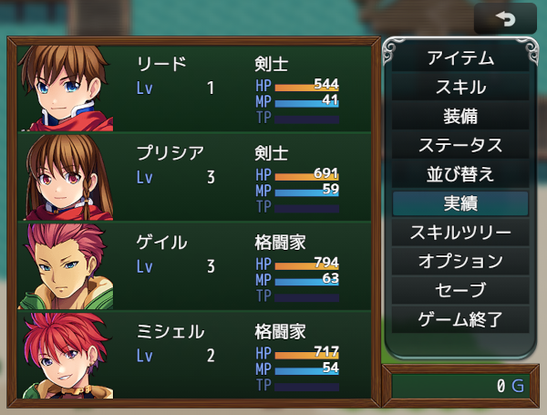

# [カスタムウィンドウフレーム](https://raw.githubusercontent.com/nuun888/MZ/master/NUUN_CustomWindowImage.js)
# Ver.1.0.0
[ダウンロード](https://raw.githubusercontent.com/nuun888/MZ/master/NUUN_CustomWindowImage.js)  

## 概要
ウィンドウのスキンやツクール規格以外のウィンドウ画像を設定できます。  
ウィンドウスキンやウィンドウ画像はウィンドウ毎またはシーン毎に指定できます。  
ウィンドウ画像はツクール規格以外の画像を設定でき、３スライス、９スライスに対応しています。  

  
ウィンドウ画像素材はねくら様のファンタジーゲームUI画像素材集を使用しております。  

## 設定
### ウィンドウ設定
適用ウィンドウ設定と適用シーン設定がどちらも未指定の場合、すべてのシーンのすべてのウィンドウに適用されます。  
適用ウィンドウ設定のみ指定した場合、指定したウィンドウクラスに適用されます。  
適用シーン設定のみ指定した場合、指定したシーン内のすべてのウィンドウに適用されます。  
両方を指定した場合、指定したシーン内の指定したウィンドウクラスにのみ適用されます。  
上記の何れかの条件に当てはまらない場合はデータベースのウィンドウスキンが表示されます。  

リストにないクラスは該当するクラスを直接記入してください。  
例:Window_Base  

## プラグインコマンド
### ウィンドウ、ウィンドウカラーの変更
ウィンドウ設定IDにプラグインパラメータのウィンドウ設定の識別名またはリストIDを指定してください。  
変更対象は指定した設定の条件に一致したウィンドウのみ適用されます。  
初期化を行う場合はウィンドウ設定IDを空白にしてください。  
ウィンドウカラーの初期化を行う場合はウィンドウカラーを空白(Deleteキー)にしてください。  

## 仕様
このプラグインで適用したウィンドウスキン及びウィンドウ画像はイベントコマンドのウィンドウカラーの変更での変更は行えません。  
プラグインコマンドのウィンドウ、ウィンドウカラーの変更で変更を行ってください。  
ウィンドウ画像はウィンドウカラーの変更は行えません。  

## 更新履歴
2026/10/10 Ver.1.0.0
初版
