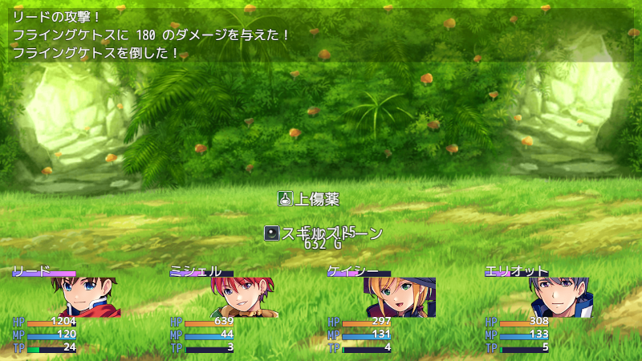

# [撃破時ドロップポップアップ](https://raw.githubusercontent.com/nuun888/MZ/master/NUUN_DefeatDropPopup.js)
# Ver.1.1.0
[ダウンロード](https://raw.githubusercontent.com/nuun888/MZ/master/NUUN_DefeatDropPopup.js)
#### 無償ライセンス
クレジット表記：任意  
商業利用：可能  
改変：可能  
再配布：可能  
当リポジトリ内、公式フォーラム、正規販売サイト以外からのダウンロード、改変済みの場合はサポートは対象外となります。  
#### 必須、前提プラグイン
[ポップアップ拡張](https://github.com/nuun888/MZ/blob/master/README/PopupEx.md)Ver.1.2.0以降  

敵を倒した際に得る報酬を撃破時にポップアップ表示します。報酬は戦闘終了時に取得されます。  
なおこのプラグインはNUUN_PopupExの拡張プラグインです。  

※他ポップアッププラグインとの競合対応は行いません。  
以下のプラグインでのみ対応を行います。(VisuMZ_1_BattleCoreを除く)  
[撃破時ドロップ(単独動作版)]  

  

以下のプラグインと併用することにより個性的なポップアップを表示できます。  
[アップフェードアウトポップアップ](https://github.com/nuun888/MZ/blob/master/README/UpFadeoutPopup.md)  
[スライドフェードアウトポップアップ](https://github.com/nuun888/MZ/blob/master/README/SlideFadeoutPopup.md)  
[バウンドポップアップ](https://github.com/nuun888/MZ/blob/master/README/LateralBoundPopUp.md)  
ポップアップを適用させるには、適用クラスに'Sprite_PopUpEX'を指定するか何も設定していない状態にしてください。  

## 更新履歴
2026/10/15 Ver.1.1.0  
NUUN_Baseなしで実行できるように仕様を変更。  
NUUN_EventTargetActionまたはNUUN_SymbolEncounterとの併用でスキップ戦闘が発生するとエラーが出る問題を修正。  
2025/10/4 Ver.1.0.1  
アクター戦闘不能時にエラーが出る問題を修正。  
2025/9/30 Ver.1.0.0  
初版  
